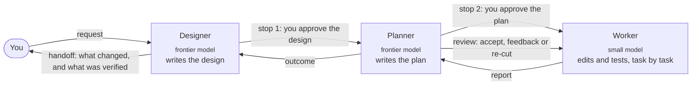

<p align="center">
  
</p>

<p align="center">
  <b>A coding assistant where an expensive model decides, a cheap model types,<br>
  and plain code records and checks everything.</b>
</p>

<p align="center">
  
  
  
</p>

<p align="center">
  <a href="#how-it-works">How it works</a> ·
  <a href="#what-you-can-rely-on">Guarantees</a> ·
  <a href="#getting-started">Getting started</a> ·
  <a href="docs/configuration.md">Configuration</a> ·
  <a href="#documentation">Docs</a>
</p>

<p align="center">
  
</p>

---

## Why Chickadee

Most coding agents run one frontier model for everything: reading, planning, typing out code and
re-running tests. That is expensive, and most of those tokens are not hard thinking.

Chickadee splits the work by difficulty:

- **A frontier model designs.** You talk to the **designer**, which reads your repository, asks
  what it needs to and writes a design. The designer never edits a file.
- **A planner cuts the work.** The **planner** turns the approved design into a short plan of tasks,
  and reviews each result.
- **A small model builds.** The **worker**, which can be a cheap or local model, does each task:
  it reads code, edits files and runs tests in an isolated copy of your repository.
- **Plain code records and guards everything.** Every edit is snapshotted and every command is
  sandboxed. Every effect is written to a journal before it happens, so a run can be stopped,
  inspected, undone and resumed.

**The bet:** solve nearly as many tasks as a frontier-only harness (at most 5 percentage points
fewer) for at most half the cost. That is a hypothesis under test, not a result.

## How it works



1. **Design.** The designer reads the code and writes a design in markdown. You approve it at **stop 1**.
2. **Plan.** The planner writes the plan, a list of tasks. You approve it at **stop 2**. For a
   small change, the designer writes a plan of one task and the planner's step is skipped.
3. **Work.** The worker does each task in the session's own worktree. Every edit is snapshotted,
   and each accepted task becomes one commit that `undo` can take back.
4. **Check.** The planner runs the tests for each task, and the full suite as a final check.
5. **Hand off.** The designer reports what changed, what ran, and what was *not* independently
   verified.

<p align="center">
  
  <br><sub>The home screen. The designer, planner and worker each have a pane, and the header shows the models in use and the session's spend against its cap.</sub>
</p>

## What you can rely on

- **Models cannot act directly.** They make tool calls, and policy code decides. Writes go
  through one edit port, and commands run only inside a sandbox.
- **Verification is never overstated.** Tests the worker writes during a run guide the work, but
  they are not counted as proof. If you supplied no acceptance tests, the handoff says so.
- **Everything can be undone.** Every turn is snapshotted, and each accepted task is one commit
  that `undo` takes back. For full isolation, a session can work in its own git worktree, so
  your checkout changes only when you merge. Approval prompts are kept for what can't be
  undone: network access, credentials, destructive git, and overwriting something with no saved
  prior state.
- **Everything is resumable.** The journal is the single source of truth. A crash, an interrupt
  or a closed terminal loses nothing, and recovery checks what actually happened before it
  retries anything.
- **Spend is capped.** Each session has a hard spend cap and warning thresholds, shown live in
  the header. Hitting the cap pauses the run in a resumable state.
- **Bring your own models.** Every role points at any OpenAI-compatible endpoint, hosted or
  local ([configuring models](docs/configuration.md#models-rungs-and-roles)). A repository's own config can
  never repoint a model or raise a spend cap.

## Getting started

> [!NOTE]
> Chickadee is pre-alpha. It runs, but expect rough edges and breaking changes.

You need **Python 3.12+**, **[uv](https://docs.astral.sh/uv/)**, **git**, a sandbox
([bubblewrap](https://github.com/containers/bubblewrap) on Linux; built in on macOS) and at
least one OpenAI-compatible model endpoint.

```bash
git clone https://github.com/kundan9170/chickadee.git
cd chickadee
uv sync --all-packages
uv run chickadee setup     # writes ~/.config/chickadee/config.toml and checks the sandbox
```

Add your models to `~/.config/chickadee/config.toml`, then, in the repository you want to work
on:

```bash
uv run --project ~/path/to/chickadee chickadee init   # index the repository
uv run --project ~/path/to/chickadee chickadee tui    # open the interface
```

**[The configuration guide](docs/configuration.md)** covers every option with its default, and
[`examples/`](examples/) has a minimal config and a complete one to start from.

## Documentation

| Start with | For |
|---|---|
| [`docs/configuration.md`](docs/configuration.md) | Installing, configuring models and roles, every option |
| [`docs/architecture.md`](docs/architecture.md) | The shape of the system, its roles and the task loop |
| [`docs/safety.md`](docs/safety.md) | What the harness guarantees, and its known limits |
| [`docs/evaluation.md`](docs/evaluation.md) | How the cost and solve-rate bet is being measured |

## Repository layout

```text
packages/
  core/       chickadee: the engine (journal, edit port, executor, sandbox, context, graph, roles)
  cli/        chickadee_cli: the command line and the TUI
  serve/      the engine server every frontend talks to, over one socket
  wire/       the one client every frontend uses
  eval/       chickadee_eval: the E1/E2/E3 measurement rig
  testing/    shared test helpers: engines, repositories, sandboxes
docs/         architecture, safety, configuration, evaluation and images
examples/     a minimal config and a complete one
profiles/     per-language profiles: test runners and conventions
ui/           the inspector
scripts/      the repository's checks
```

## Contributing

[`CONTRIBUTING.md`](CONTRIBUTING.md) explains how to set up, the checks CI runs and the design
rules every change keeps. Report security problems privately, as [`SECURITY.md`](SECURITY.md)
describes.

## License

Copyright © 2026 Kundan Kumar. All rights reserved. Chickadee is proprietary software. The source
is visible here for review, but no licence to use, copy, modify or distribute it is granted. See
[`LICENSE`](LICENSE) and [`NOTICE`](NOTICE) for third-party material.
