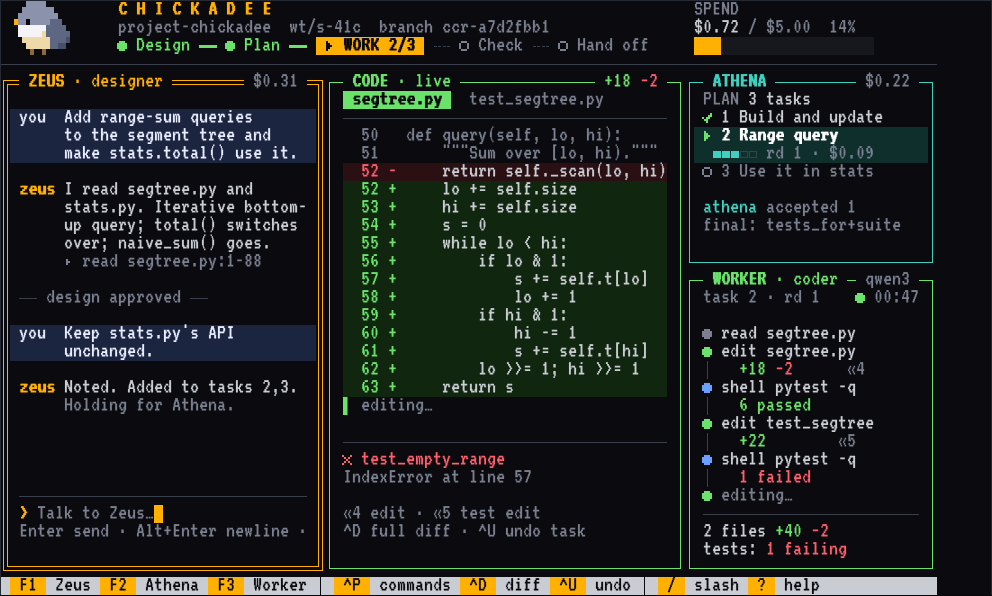
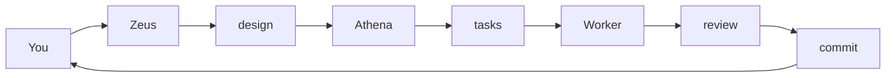

# Chickadee

A coding agent where an expensive model decides, a cheap model types, and plain code checks every step.

[](https://github.com/kundan9170/chickadee/actions/workflows/ci.yml)
[](LICENSE)
[](pyproject.toml)



*A design mockup of the terminal UI, not a capture of a live session.*

## Why

Most of a coding agent's tokens go to routine editing, but most agents run a frontier model
for all of it. Chickadee splits the work: a frontier model designs the change and reviews it,
a cheaper model does the editing, and deterministic code records every step, runs the tests
and can undo any of it. The bet is that this solves nearly as many tasks for much less money.
That is a hypothesis, and it is still being measured: see [evaluation](docs/evaluation.md).
No result is claimed here.

## Features

- **Design, then plan, then tasks.** You approve the design and the plan before any code is written.
- **One task, one commit.** Each accepted task is a single commit, and `undo_task` reverts it.
- **Every write is a recorded step.** Edits go through one edit port, each with a snapshot of the tree.
- **Sandboxed commands.** The worker's shell writes only its worktree, with no network.
- **A hard spend cap.** Reaching it ends the run in a resumable state, never a silent overspend.
- **A journal you can replay.** State is a fold over the journal; crashed runs resume from it.

## Quick start

You need Python 3.12 or later and [uv](https://docs.astral.sh/uv/).

```bash
git clone https://github.com/kundan9170/chickadee.git
cd chickadee
uv sync --all-packages

uv run chickadee setup      # writes ~/.config/chickadee/config.toml if absent, probes the sandbox
```

Edit `~/.config/chickadee/config.toml` to point at your models, or start from
[`examples/config.toml`](examples/config.toml) (see [configuration](docs/configuration.md)).
Any OpenAI-compatible endpoint works. Export the API key variable your config names, then run
Chickadee in a git repository:

```bash
cd /path/to/your/repo
uv run --project /path/to/chickadee chickadee            # the conversation
uv run --project /path/to/chickadee chickadee tui        # the terminal UI
uv run --project /path/to/chickadee chickadee --help     # every command
```

`chickadee setup` reports whether the sandbox can run. On Linux it needs
[bubblewrap](https://github.com/containers/bubblewrap) (`sudo apt install bubblewrap`).

## How it works

| Role | Job |
|---|---|
| **Zeus** | Talks to you, reads the repository, writes a design. |
| **Athena** | Turns the approved design into a plan, delegates tasks one at a time, reviews each report. |
| **Worker** | Edits and runs commands for one task, in a sandboxed worktree, then reports. |



Zeus and Athena run on a frontier model. The worker can run on a cheaper or local one. You can
point each of them at any OpenAI-compatible model. The full picture is in
[architecture](docs/architecture.md).

## Safety

- Models propose; harness code performs every effect.
- Every edit is a recorded step that can be undone.
- Commands run in a sandbox, and risky ones ask first.
- Every run has a finite spend cap.
- A completed run never claims the change is right: it reports what ran.

Details and limits are in [safety](docs/safety.md).

## Status

Chickadee is a working prototype for personal use. The task loop, the edit port, the sandbox,
the journal with resume, the budget caps, the command line and the terminal UI are built and
tested. Not yet done: running the E2 cost experiment, hardening against prompt injection, and
anything for untrusted repositories or several users. Expect rough edges.

## Documentation

- [Architecture](docs/architecture.md)
- [Safety](docs/safety.md)
- [Configuration](docs/configuration.md)
- [Evaluation](docs/evaluation.md)

## Contributing

See [CONTRIBUTING.md](CONTRIBUTING.md).

## License

AGPL-3.0-or-later, see [LICENSE](LICENSE). It includes code ported from OpenAI Codex under
Apache-2.0, see [NOTICE](NOTICE).

## Acknowledgements

The command classifier's shell parsing rules and tests are adapted from
[OpenAI Codex](https://github.com/openai/codex). The evaluation rig uses the
[Aider polyglot benchmark](https://github.com/Aider-AI/polyglot-benchmark).
