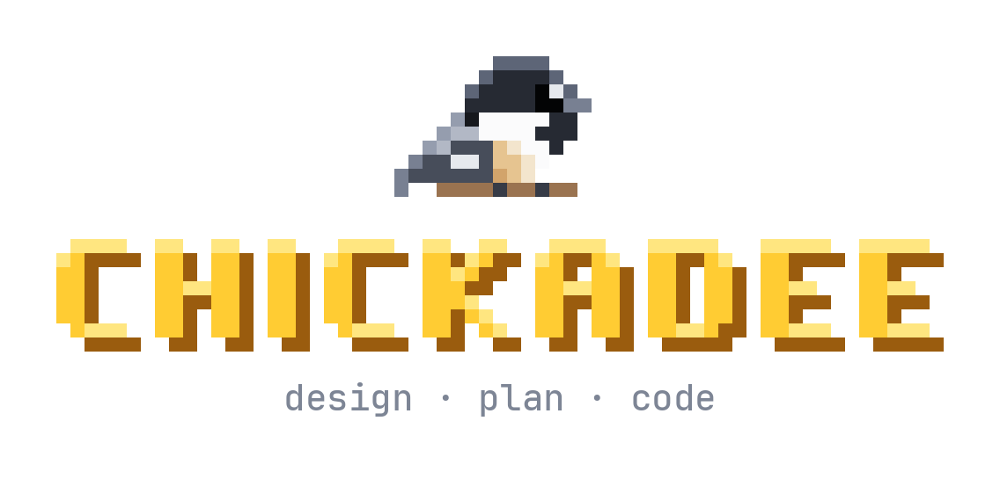
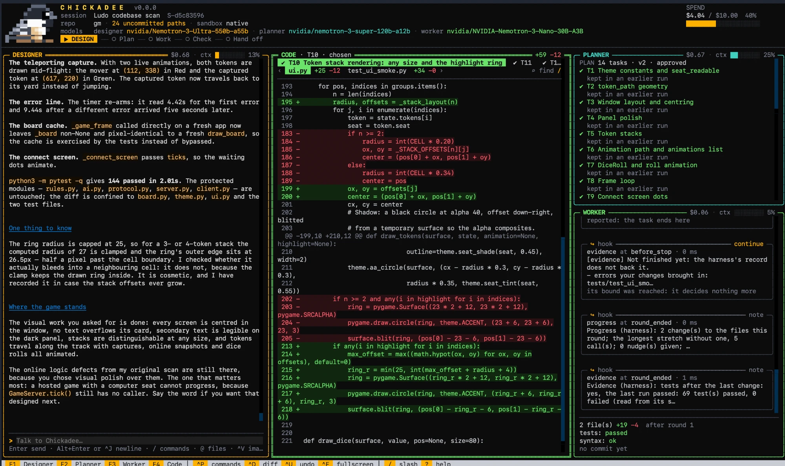
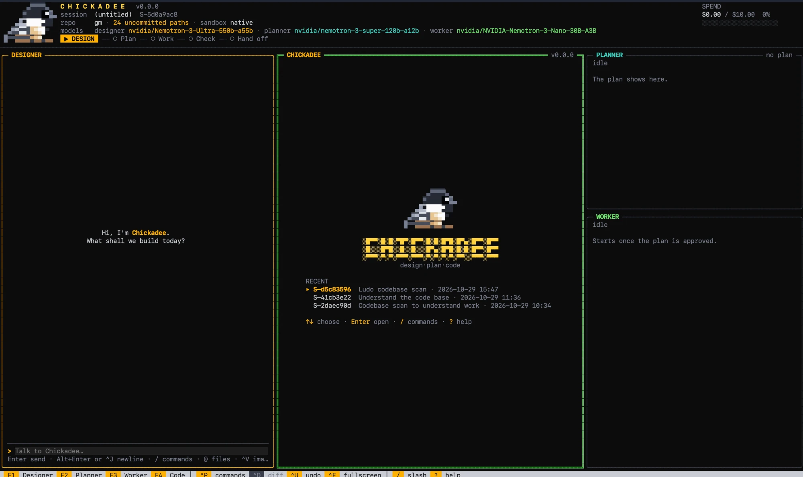

<p align="center">
  
</p>

<p align="center">
  <b>A coding assistant where an expensive model decides, a cheap model types,<br>
  and plain code records and checks everything.</b>
</p>

<p align="center">
  
  
  
</p>

<p align="center">
  <a href="#getting-started">Getting started</a> ·
  <a href="#configuration">Configuration</a> ·
  <a href="#documentation">Docs</a>
</p>

<p align="center">
  
</p>

---

## Why Chickadee

Most coding agents run one frontier model for everything: reading, planning, typing out code and
re-running tests. That is expensive, and most of those tokens are not hard thinking.

Chickadee splits the work by difficulty:

- **A frontier model designs.** You talk to the **designer**, which reads your repository, asks
  what it needs to and writes a design. The designer never edits a file.
- **A planner cuts the work.** The **planner** turns the approved design into a short plan of tasks,
  and reviews each result.
- **A small model builds.** The **worker**, which can be a cheap or local model, does each task:
  it reads code, edits files and runs tests in an isolated copy of your repository.
- **Plain code records and guards everything.** Every edit is snapshotted and every command is
  sandboxed. Every effect is written to a journal before it happens, so a run can be stopped,
  inspected, undone and resumed.

**The bet:** solve nearly as many tasks as a frontier-only harness (at most 5 percentage points
fewer) for at most half the cost. That is a hypothesis under test, not a result.

<p align="center">
  
  <br><sub>The home screen. The designer, planner and worker each have a pane, and the header shows the models in use and the session's spend against its cap.</sub>
</p>

## Getting started

> [!NOTE]
> Chickadee is pre-alpha. It runs, but expect rough edges and breaking changes.

You need **Python 3.12+**, **[uv](https://docs.astral.sh/uv/)**, **git**, a sandbox
([bubblewrap](https://github.com/containers/bubblewrap) on Linux; built in on macOS) and at
least one OpenAI-compatible model endpoint.

```bash
git clone https://github.com/kundan9170/chickadee.git
cd chickadee
uv sync --all-packages
uv run chickadee setup     # writes ~/.config/chickadee/config.toml and checks the sandbox
```

Add your models to `~/.config/chickadee/config.toml` (see [Configuration](#configuration) below),
export the API key it names, then, in the repository you want to work on:

```bash
uv run --project ~/path/to/chickadee chickadee init   # index the repository
uv run --project ~/path/to/chickadee chickadee tui    # open the interface
```

## Configuration

### The main config file

**`~/.config/chickadee/config.toml`** is the one file you need. It holds your models, their
prices and your spend cap. `chickadee setup` writes a commented starting copy there, and never
overwrites one you already have. You can also start from
[`examples/config.toml`](examples/config.toml) (the minimum) or
[`examples/config.full.toml`](examples/config.full.toml) (every table).

Settings are read in layers, and a later layer overrides an earlier one key by key:

| # | Layer | Where | Use it for |
|---|---|---|---|
| 1 | Defaults | built in | |
| 2 | **User** | `~/.config/chickadee/config.toml` | **Your models, prices, spend cap and sandbox. The main file.** |
| 3 | Project | `<repo>/.chickadee/config.toml`, committed | Only `profiles`, `secrets`, `commands` and `hooks` |
| 4 | Local | `work.toml`, in the repository's local state | Your overrides for one clone |
| 5 | Environment | `CHICKADEE_*` variables | A change for a single run |

A repository's own file can never repoint a model, set a price or raise your spend cap, so
cloning someone else's repository cannot spend your money. Anything else it tries is refused
at load.

### A minimal working config

```toml
# 1. The spend cap. Required: a run will not start without a finite cap.
[spend]
hard_cost_usd = 5.00                 # the run stops here, in a state you can resume
warning_fractions = [0.5, 0.8]       # warn at 50% and 80% of the cap

# 2. Your models. Each one is any OpenAI-compatible endpoint.
[models.frontier]
base_url = "https://api.example.com/v1"
model_id = "your-frontier-model"
api_key_env = "FRONTIER_API_KEY"     # the key is read from this variable, never stored here
context_window = 200000
max_output_tokens = 32000

[models.local]
base_url = "http://localhost:8000/v1"
model_id = "your-local-coder"
context_window = 131072
max_output_tokens = 16384

# 3. Prices, in USD per million tokens. Every model needs one.
[prices.frontier]
price_in = 3.00
price_out = 15.00

[prices.local]
price_in = 0.20
price_out = 0.60

# 4. Which model each role runs on.
[rungs]
high-param = "frontier"              # the designer and the planner
mid-param = "frontier"               # helpers: locate, critic, reviewers
low-param = "local"                  # the worker
```

Then export the key the config names:

```bash
export FRONTIER_API_KEY=...
```

### The main settings explained

| Setting | What it does |
|---|---|
| `[spend] hard_cost_usd` | The hard spend cap for a run, in USD. Required, and must be above zero. Reaching it pauses the run in a resumable state. |
| `[spend] warning_fractions` | The fractions of the cap at which you are warned, e.g. `[0.5, 0.8]`. |
| `[spend.rungs]` | An optional cap per rung beneath the total, e.g. `high-param = 3.00`. |
| `[models.<name>]` | One model endpoint. `base_url` and `model_id` say where and what. `api_key_env` names the environment variable holding the key. `context_window` and `max_output_tokens` give its limits. |
| `[prices.<name>]` | Input and output price per million tokens for the model of the same name. Price a local model at a hosted equivalent, so the cap and cost figures stay honest. |
| `[rungs]` | Maps each rung to a model. `high-param` runs the designer and the planner, `mid-param` the helper roles, `low-param` the worker. One model can serve several rungs. |
| `[roles]` | Optional: moves a role onto a different rung. |
| `[workspace] mode` | `in_place` (default) works in your checkout, with snapshots to undo. `worktree` works in a separate git worktree, so your checkout changes only when you merge. |
| `[work] dir`, `commit` | Where designs and plans are written (default `docs/chickadee`), and whether they are committed. |
| `[sandbox] backend` | `auto` (default), `native` (bubblewrap on Linux, Seatbelt on macOS) or `none`. |
| `[secrets] deny_add` | Extra paths kept out of the models' reach, e.g. `["**/credentials.json"]`. |

To change a setting for a single run, use an environment variable. A double underscore
separates the table from the key:

```bash
CHICKADEE_SPEND__HARD_COST_USD=2 uv run chickadee
```

To check a config file, run `chickadee setup` again: it reports the cap in force and whether
the sandbox can run. **[The configuration guide](docs/configuration.md)** lists every option
with its default, plus approval preferences, command rows and hooks.

## Documentation

| Start with | For |
|---|---|
| [`docs/configuration.md`](docs/configuration.md) | Installing, configuring models and roles, every option |
| [`docs/architecture.md`](docs/architecture.md) | The shape of the system, its roles and the task loop |
| [`docs/safety.md`](docs/safety.md) | What the harness guarantees, and its known limits |
| [`docs/evaluation.md`](docs/evaluation.md) | How the cost and solve-rate bet is being measured |

## Repository layout

```text
packages/
  core/       chickadee: the engine (journal, edit port, executor, sandbox, context, graph, roles)
  cli/        chickadee_cli: the command line and the TUI
  serve/      the engine server every frontend talks to, over one socket
  wire/       the one client every frontend uses
  eval/       chickadee_eval: the E1/E2/E3 measurement rig
  testing/    shared test helpers: engines, repositories, sandboxes
docs/         architecture, safety, configuration, evaluation and images
examples/     a minimal config and a complete one
profiles/     per-language profiles: test runners and conventions
ui/           the inspector
scripts/      the repository's checks
```

## Contributing

[`CONTRIBUTING.md`](CONTRIBUTING.md) explains how to set up, the checks CI runs and the design
rules every change keeps. Report security problems privately, as [`SECURITY.md`](SECURITY.md)
describes.

## License

Copyright © 2026 Kundan Kumar. All rights reserved. Chickadee is proprietary software. The source
is visible here for review, but no licence to use, copy, modify or distribute it is granted. See
[`LICENSE`](LICENSE) and [`NOTICE`](NOTICE) for third-party material.
