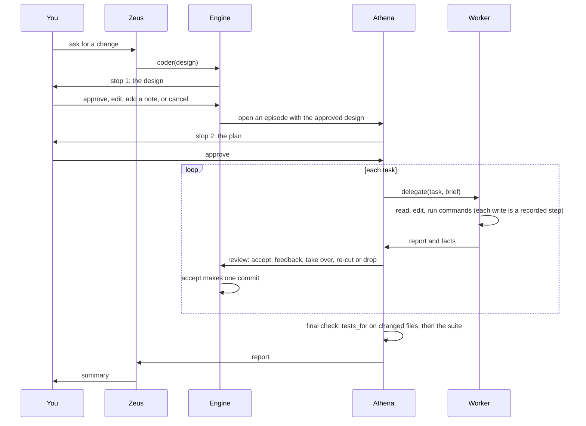

# Architecture

Chickadee is one task loop. A frontier model designs, a second frontier session plans and
reviews, a cheaper model does the editing, and plain code records, checks and undoes
everything. This page describes how a request moves through the system and which part owns
what.

## The roles

Each role runs on a *rung*, a named model slot you point at any OpenAI-compatible model (see
[configuration](configuration.md)). Two roles use judgment and are named; the rest do a bounded
job.

| Role | Rung (default) | Job | Writes files? |
|---|---|---|---|
| **Zeus** | `high-param` | Holds the conversation, reads the repository, writes a design or a one-task plan, answers you. | No source-editing tools. It writes only its design documents, in the work folder, through `doc`. |
| **Athena** | `high-param` | Turns an approved design into a plan, delegates one task at a time, reviews each report, runs the final check. | Only through the edit port, and only for a task she takes over. |
| **Worker** | `low-param` | Reads, edits and runs commands for one task, then reports. | Through the edit port and a sandboxed shell. |
| **locate** | `mid-param` | Finds where something lives in the code. | No |
| **critic**, **reviewer**, **reader**, **researcher** | `mid-param` | Read-only helpers that Zeus can spawn. The reviewer can run commands at the lowest tier. | No |
| **residue**, **checkpoint**, **title** | various | Single model calls with no tools: summaries and a session name. | No |

The table is generated from `ROLES` in `packages/core/src/chickadee/roles.py`, which is the one
list of roles. A role is a trust boundary: its tools, its call cap and its permissions are
fixed there, and configuration can only choose within them.

## One request

1. **Design.** Zeus writes a design in Markdown and calls `coder`. For a small change it can
   instead write a one-task plan, which skips stop 1.
2. **Stop 1.** You see the design. You can approve it, edit it, send a note (Zeus revises), or
   cancel. Unattended runs approve automatically.
3. **Plan.** Athena writes a plan with a list of tasks. You see it at stop 2 and approve, edit,
   or send a note.
4. **Tasks.** Athena delegates one task at a time. The worker reads files, edits them and runs
   commands inside the session's worktree, then replies with a report. The harness adds
   *facts* it measured itself: which files changed, whether the syntax checks pass, which tests
   ran and what happened.
5. **Review.** Athena reviews each report and answers `accept`, `feedback` (another round on
   the same conversation), `take_over`, `re_cut` (replace the task with smaller ones, to a
   bounded depth) or `drop` (put everything back).
6. **Commit.** `accept` makes one commit for the task. `undo_task` reverts it.
7. **Final check.** After the last task Athena runs `tests_for` on every changed file and then
   the suite, and her reply becomes the report Zeus reads.

No step refuses a change for its quality. The tests run, and the result is a fact in the
report. You decide whether the change is right.

## The edit port

Every write a model makes reaches the worktree through one module, `box/edits.py`. A call is
all or nothing over the files it names. It refuses paths that escape the repository, that
point into `.git`, that match the secret-path denylist or your own `deny` globs, and content
that would silently empty a file. A syntax error an edit introduces is reported, so the model
can fix it, or the edit is refused, depending on the model's setting.

The edit tools come in three shapes: by text (`edit`, `create`, patch), by line (anchored
`replace_lines`, `insert_lines`) and by symbol. A model's config picks which shape it is
offered.

## Steps and undo

A *step* is one writing call, an edit or a shell command, together with a snapshot of the
worktree taken afterwards. Each step is written to the journal as an effect:
`effect_intended`, `effect_started`, `effect_completed`, with a stable `operation_id`. Because
each step has a snapshot, `drop` and `undo_task` restore the exact tree from before.

## The sandbox

Commands run through one place, `ProcessSupervisor`, and are wrapped by an isolation backend:
bubblewrap on Linux, Seatbelt on macOS, or a container. The worker's shell can write the
worktree and nothing else, with `.git` read-only and no network. A command that needs the
network, credentials or anything destructive is asked about first. See [safety](safety.md).

## The journal and resume

The journal is the single source of truth. A run's state is a fold over its journal, and
in-memory state is only a projection. Every effect is written ahead of time, so after a crash
the harness observes what actually happened and reconciles before it retries anything. A paused
or crashed run resumes from its journal. `chickadee replay` folds a run's journal and says
whether it replays identically.

## Worktrees and leases

Delegated work runs in a git worktree leased to the session, under a repository-wide write
lease, so two sessions never write the same tree. `--in-place` runs in your checkout instead,
for quick bounded work; it snapshots your existing uncommitted changes first and does not
commit.

## Packages

| Package | Contents |
|---|---|
| `packages/core` | The engine: roles, task loop, edit port, sandbox, journal, budget, approval, graph |
| `packages/serve` | Serves the engine over a local socket |
| `packages/wire` | A typed client for that server |
| `packages/cli` | The `chickadee` command: REPL and terminal UI |
| `packages/eval` | The benchmark rig behind the cost claim, see [evaluation](evaluation.md) |

The CLI and the TUI are thin clients: they talk to an engine hosted in the same process, or to
`chickadee serve` over its socket, through the same wire.
